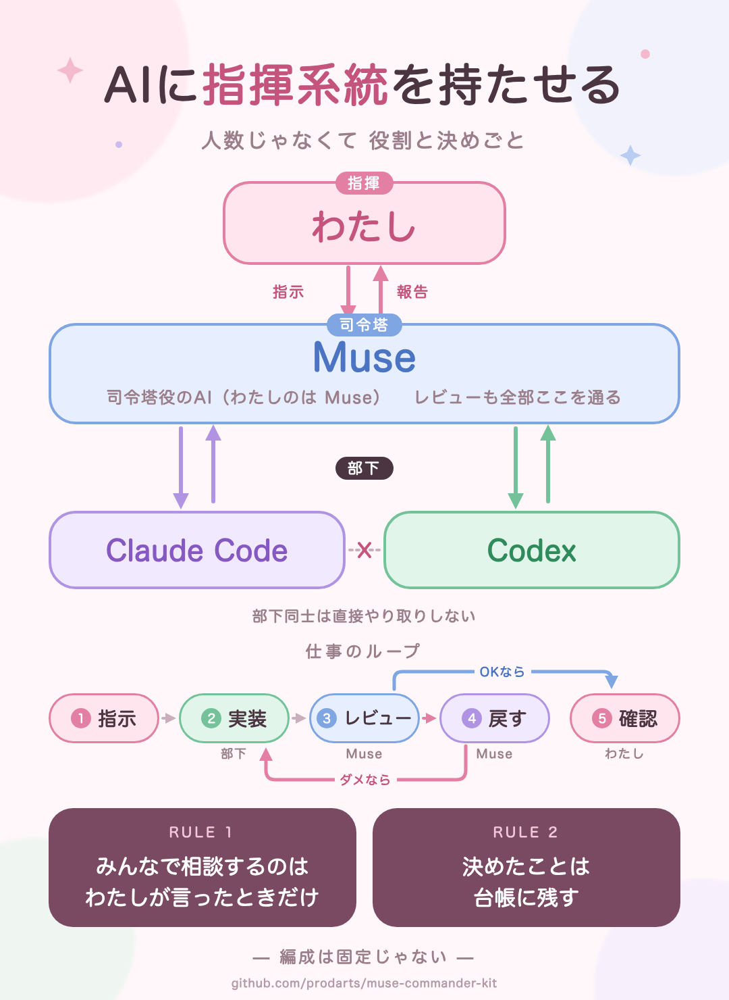

# AIに「指揮系統」を持たせる — Muse 司令塔キット

AIに毎回同じ説明をしていませんか。

- 前に決めたことを、また聞かれる
- 昨日の続きなのに、最初から説明し直し
- AIが複数あるのに、使い分けはその場のノリ

このキットは、その状態を抜けるための**運用の型**です。飲食店の現場運営をしながら、実際にこの形で Muse と複数のAIエージェントを回している筆者の実践記録をもとにしています。製品ではありません。サポートもしません。使える所を使ってください。

> **Muse とは**：筆者が司令塔として使っているAIアシスタント（Meta の Muse）のことです。このキットでは「司令塔役のAI」という意味で使っています。自分の環境では、ふだん使っているAIアシスタントに読み替えてください。
> 司令塔に必要な能力は、パターン A では「ファイルを読み書きできて、記憶を持てること」。B〜D では、それに加えて「実行機に SSH でコマンドを送れること」です。

## 本体は「人数」ではなく「指揮系統」

やることは単純です。

- **指揮は人間**。最終判断と、外部への行動（送信・投稿・支払い・削除）の承認は人間が持つ
- **Muse が司令塔**。指示を受けて、自分でやる／部下のAIに投げる／全員で相談する、を振り分ける
- **部下のAI（Claude Code、Codex など）**。実装や調査などの実作業を担当する
- **部下同士は直接やり取りしない**。レビューも報告も、全部司令塔を通る
- **みんなで相談するのは、人間が言ったときだけ**。普段は司令塔が裁く

大事なのは編成ではなく、この役割分担と「決めたことを二度聞かない仕組み」のほうです。

## 構成パターンは4つ（懐事情で選べる）

| パターン | 編成 | できること | できないこと |
|---|---|---|---|
| A | Muse 単独（無料でも可） | 判断ルール＋裁定台帳だけでも「二度聞かない」は実現できる | 実作業の並行処理 |
| B | Muse ＋ Codex | 重い実装・調査を投げて、Muse は進行管理と報告に徹する形が作れる | デザイン系の詰めは弱い |
| C | Muse ＋ Claude Code | 設計・文章・見た目の仕事が強い | 週あたりの使用枠が先に尽きやすい |
| D | 3者フル | 相談（3者協議）、得意分野での分業、片方が枠切れのときの代替が全部できる | 運用の手間と契約が最大 |

**最初は A（今日から、追加費用なし）で十分です。** 台帳がたまって運用に慣れたら B 以降へ。足りなくなったら足す、それで成立するのがこの型の利点です。

実際に効いた場面を1つ。前に「削除した伝票もバック計算に入れる」と決めて台帳に入れておいたら、翌月の集計で Muse が説明なしにその通りに処理してきました。決めたことを二度聞かれない、というのはこういう形で効きます。

## 必要なもの

| | A | B〜D |
|---|---|---|
| 司令塔AI（Muse 相当） | 要 | 要（SSH でコマンドを送れること） |
| 常時電源ONの PC（筆者は Mac） | 不要 | 要 |
| Tailscale（無料枠で可） | 不要 | 要 |
| Claude Code／Codex の契約 | 不要 | 使う方だけ |
| 共有ドライブ（Google Drive など） | 推奨（台帳の正本置き場） | 推奨 |

## 振り分けの実例

- 軽い調べ物・要約・件数確認 → Muse が自分でやる（相談しない）
- 大きな実装 → Codex に指示書を渡して投げる。Muse はレビューと報告だけ
- 見た目が要る制作物 → Claude Code に絵コンテから作らせる。人間がコンテを承認してから本制作
- 判断が割れそうな大きな決定 → 人間の指示で3者協議。各AIが案を出し、互いに批判し、**食い違いは潰さずに人間に見せる**

## 仕組みを支える3つの道具

1. **判断ルール（SOUL）** — 司令塔の判断基準と話し方を書いたファイル。人格の演出ではなく「迷ったらどう決めるか」の仕様書にする（`templates/SOUL.template.md`）
2. **裁定台帳** — 人間が下した判断をルール化して貯める場所。同じ判断を二度聞かなくなる（`docs/ruling-ledger.md`）
3. **セッションルール** — 部下AIへの投げ方は新規セッション＋ファイルで状態を渡すのが基本。再開（resume）は条件付き（`docs/session-rule.md`）

## 始め方

手で読んで進めることも、自分のAIに渡して構築させることもできます。

手で進める場合：
1. このリポジトリを「Use this template」で自分のリポジトリとして複製する
2. `templates/` の3ファイルを自分の環境に置き換えて書き始める（最初はスカスカでいい）
3. Muse に「あなたは司令塔です」と役割を宣言し、最初の仕事を1つ任せる
4. 判断を下すたびに、裁定台帳へ1行足す

AIに構築させる場合：
- このリポジトリ全体を、自分のAIの作業場所に取得させる（リンクだけではファイルに届かないことがある）
- そのうえで、こう頼む：「skills/commander-setup/SKILL.md を読み、その手順で私の環境に司令塔の構成を作って」
- AIが `docs/setup-full.md` の手順を順に進める。ログインや鍵の承認など本人でないとできない手順は、AIが案内するので、その都度自分で操作する
- 裁定台帳の正本は Google Drive などの共有ドライブに置く（司令塔が読み書きし、部下へは必要なルールを指示書に添えて渡す）

## 正直な注意

- このキットは筆者の環境（Mac＋各種サブスクリプション）での実践が元です。丸ごとの再現には相手側の環境構築が要ります
- 効果は「魔法のプロンプト」ではなく、地味な記録の蓄積から出ます。裁定台帳を貯めないと、ただの役割分担で終わります
- つまずきどころは `docs/setup-full.md` の末尾に実例でまとめてあります。きれいな成功談だけを信じないでください

ライセンス：CC BY 4.0（`LICENSE` 参照）。使える所を使ってください。サポートはしません。
